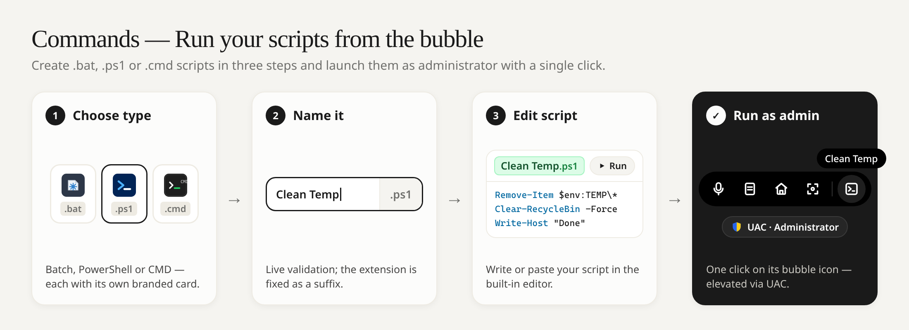
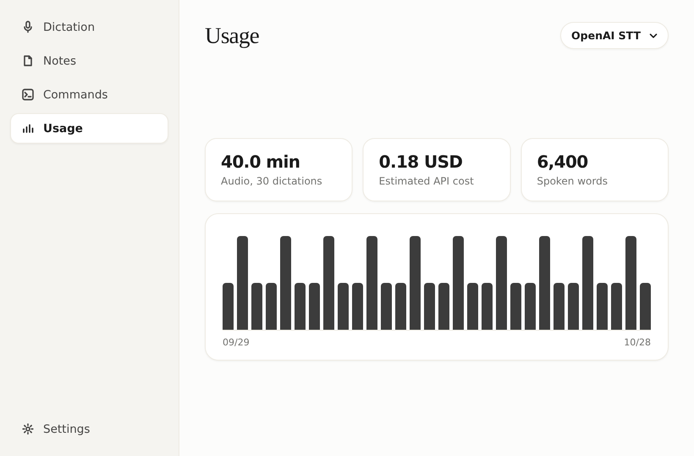

<p align="center">
  <a href="https://github.com/LuiInventions/OpenFlow">
    
  </a>
</p>

<p align="center">
  <a href="https://github.com/LuiInventions/OpenFlow/stargazers"></a>
  <a href="https://github.com/LuiInventions/OpenFlow/releases/latest"></a>
  <a href="LICENSE"></a>
</p>

**OpenFlow** is a fast, local-first voice dictation, quick notes, and screenshot dock for Windows. It comes bundled with the open-source **Parakeet v3** (`parakeet-tdt-0.6b-v3`) speech recognition model for 100% offline, zero-cost dictation—and also supports your own optional **OpenAI API key** (`gpt-transcribe`). All notes, dictation history, usage metrics, and settings stay locally on your PC.

The compact dark-black floating bubble rests at the bottom of your screen. Hold `Ctrl` + `Win`, speak naturally, and release: OpenFlow transcribes your voice and pastes the text directly into the focused input field—or automatically saves and opens it in the Notes editor when no text field is active.

---

## Floating Bubble & Symbols

<p align="center">
  
</p>

When idle, the floating bar collapses into a subtle, symmetrically clipped pure-black pill at the bottom of the screen. Moving your cursor into its immediate vicinity expands it to reveal your action icons, and moving away in any direction snaps it shut right away. In the Settings tab under **Manage Elements**, you can freely customize the bubble: remove unused icons, add them back, and drag symbols to reorder them live.

---

## New: Quick Voice Note Capture

<p align="center">
  
</p>

---

## New: Commands — Run Your Scripts from the Bubble

<p align="center">
  
</p>

The new **Commands** tab lets you create, search and manage your own Windows scripts (`.bat`, `.ps1`, `.cmd`). A 3-step wizard guides you through picking the script type, giving it a name (the extension is fixed automatically) and writing the script in the built-in editor. Every command can be launched with administrator rights (UAC prompt) straight from the floating bubble or the app, and its bubble icon can be reordered in **Settings › Manage Elements**.

---

## Application UI & Workspace Tabs

<p align="center">
  
</p>

OpenFlow features a warm, distraction-free two-column layout (`820 × 540`) combining a clean navigation sidebar on the left and a spacious workspace on the right:

| Workspace Tab | Features & Description |
| :--- | :--- |
| **Dictation** | Displays your active dictation shortcut (`Ctrl` + `Win` by default, or `Ctrl` + `Space`, `Ctrl` + `Alt`, `Ctrl` + `Shift`), the latest transcription with a one-click **Copy** button, and your recent dictation history. |
| **Notes** | Lists all saved notes vertically in proportional, rounded cards with a clean trash icon on the right (asking for confirmation before deleting). Clicking any note—or the floating round pen-and-paper compose button in the bottom right—opens the minimalist note-bubble card over the entire Notes area (editable note title on top, no tabs, max 1 note open, with **`Back`**, **`Copy`**, and **`Save`** actions). Unsaved notes are never persisted unless you explicitly click **`Save`**, which saves your changes and returns to the Notes list. |
| **Commands** | Create, manage, and execute custom scripts (.bat, .ps1, .cmd). Includes a 3-step creation wizard (script type selection with branded logos, name validation with fixed extension suffix, script editor), search filter, and instant elevated execution (UAC prompt) directly from the floating desktop bubble or app. Seamlessly integrated into **Manage Elements** for custom bubble ordering. |
| **Usage** | Summarizes your last 30 days of activity—total recorded minutes, estimated API cost, and total spoken words—paired with an activity bar chart computed locally from your saved dictations. |
| **Settings** | • **Speech-to-Text Engine**: Switch anytime between **Parakeet v3 (Open-Source, Local)** and **OpenAI API (`gpt-transcribe`)**, and manage your optional OpenAI API key. Right after installation, OpenFlow checks whether the **Parakeet v3** model is already installed—if not, it shows a dedicated **`Installing open-source STT model`** progress window in MB before launching the UI with the onboarding prompt.<br><br>• **Dictation**: Choose your global dictation shortcut between **`Ctrl + Win` (Default)**, **`Ctrl + Space`**, **`Ctrl + Alt`**, or **`Ctrl + Shift`**, and use the mode toggle switch to switch between **Hold Shortcut to Dictate** (hold to speak, release to finish) and **Press Once to Start / Second Time to Stop**.<br><br>• **Floating Bubble & Manage Elements**: Select bubble appearance (**Active**, **Grayed Out**, or **Hidden** with shortcut-only dictation) and customize your bubble icons (drag to reorder, click − to remove, add back). |

---

## Speech-to-Text (STT) Flow

<p align="center">
  
</p>

1. **Hold & Speak (`Ctrl` + `Win` or `microphone`)**: OpenFlow captures 16-bit PCM audio at 24 kHz and monitors RMS energy + speech-band zero-crossing rates. Pure silence is discarded automatically.
2. **Transcribe (`Parakeet v3` Local or `OpenAI API`)**: Valid speech audio is sliced into 16 kHz mono WAV segments and sent either to the bundled **Parakeet v3** model (running warm in the background on your PC) or over HTTPS to `api.openai.com/v1/audio/transcriptions` (`gpt-transcribe`).
3. **Direct Paste (`Ctrl` + `V`)**: When an editable input field was focused before recording started, OpenFlow writes the transcript to the clipboard and dispatches `Ctrl` + `V` into the target window.
4. **Auto-Open Note (Fallback)**: When no text input field is focused—or if pasting is unavailable—OpenFlow automatically saves the dictated text as a new note and **immediately opens that note** in the UI.

---

## Pricing — How Much Can You Transcribe for $0.50?

<p align="center">
  
</p>

OpenFlow has **zero subscriptions or middleman fees**:

| STT Engine | Cost per Minute | What **$0.50 USD** Gets You | Highlights |
| :--- | :--- | :--- | :--- |
| **Parakeet v3 (Bundled Local)** | **$0.00 / min** | **Unlimited (`∞` hours)** | Pre-installed with OpenFlow. Runs 100% offline in the background on your PC. |
| **OpenAI API (`gpt-transcribe`)** | **$0.0045 / min** | **~111 minutes (`1 hr 51 min`)** | Over **16,600 spoken words** for just `$0.50` using your own OpenAI API key. |

---

## Installation & Building from Source

### Download Installer (Recommended)

Download the latest Windows installer from the [**Releases**](https://github.com/LuiInventions/OpenFlow/releases) page:

- **`OpenFlow-Setup-1.5.1.exe`** — Lightweight Windows NSIS Web/Stub Installer (~1 MB download) with customizable install directory, Start Menu entry, and Desktop shortcut. Automatically fetches the application package from GitHub Releases during setup, checks whether **Parakeet v3** is already installed (skipping download if present, or showing a live MB progress bar), and then opens the UI so you can choose **Local (Parakeet v3)** or **OpenAI API**.

Requirements: Windows 10 or Windows 11 (64-bit). An OpenAI API key is optional.

### Build from Source

Requires **Node.js 22+**:

```bash
npm ci
npm test
npm run dist
```

This builds the Windows NSIS Web Stub installer (`release/OpenFlow-Setup-1.5.1.exe`).

---

## Flameshot Integration & License

OpenFlow bundles the official Windows build of [Flameshot 14.0.0](https://github.com/flameshot-org/flameshot/releases/tag/v14.0.0) for its screenshot action. Flameshot is licensed under the **GNU General Public License v3.0 (GPL-3.0-only)**, and OpenFlow is distributed under the same **GPL-3.0-only** license. See [LICENSE](LICENSE) for the full license text.
