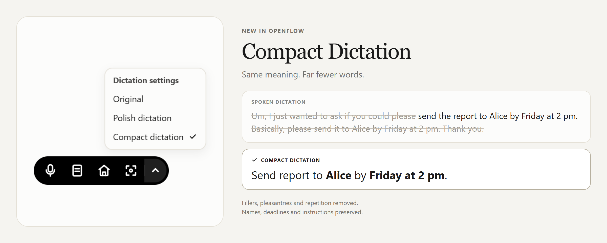
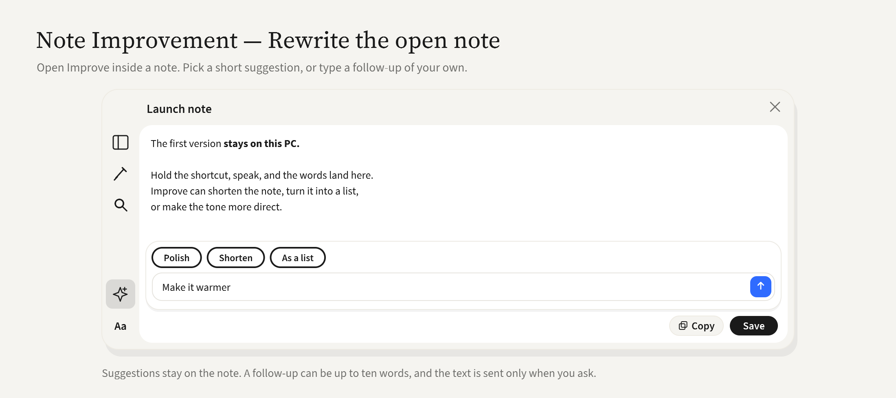
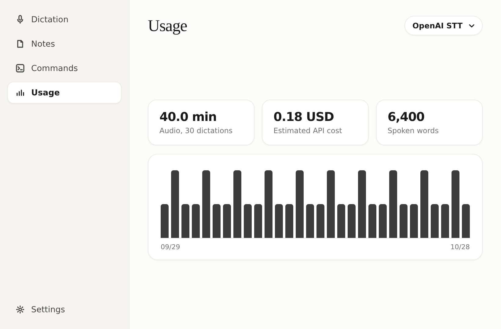

<p align="center">
  <a href="https://github.com/LuiInventions/OpenFlow">
    
  </a>
</p>

<p align="center">
  <a href="https://github.com/LuiInventions/OpenFlow/stargazers"></a>
  <a href="https://github.com/LuiInventions/OpenFlow/releases/latest"></a>
  <a href="LICENSE"></a>
</p>

**OpenFlow** is a fast, local-first voice dictation, quick notes, and screenshot dock for Windows. Choose the open-source **Parakeet v3** (`parakeet-tdt-0.6b-v3`) model for offline, zero-cost dictation, or start directly with your own **OpenAI API key** (`gpt-transcribe`) without downloading a speech model. All notes, dictation history, usage metrics, and settings stay locally on your PC.

The compact dark-black floating bubble rests at the bottom of your screen. Hold `Ctrl` + `Win`, speak naturally, and release: OpenFlow transcribes your voice and pastes the text directly into the focused input field—or automatically saves and opens it in the Notes editor when no text field is active.

---

## New in 1.5.36

- **Calmer default bubble:** new installs start without the microphone and voice-note button in the bubble. Add them anytime in **Settings → Manage Elements**; dictation by shortcut works as before.
- **Improve Dictation is a gpt-transcribe feature:** selecting Parakeet turns it off and its switch cannot be used. Choosing gpt-transcribe with a working key turns it back on (Polish).
- **Level meter on the very first recording:** right after installing, the bars no longer stand high and red without sound; a freshly opened microphone is no longer mistaken for speech.

## New in 1.5.35

- **Every dictation is transcribed and pasted:** quiet microphones (common on laptops) were sometimes treated as silence, so the loading animation was skipped and nothing was pasted. Speech is now recognised by its rhythm of syllables and pauses, not only by loudness.
- **Fewer language mix-ups with Parakeet:** live voice notes are sent in longer pieces (2–6 s instead of about 1 s on quiet microphones), giving the offline model enough context to keep your language. Parakeet never translates, but on very short clips it can mistake the language.
- **Setup screen:** no blue check until you choose an engine; the download button now reads **Download**; **Continue** is greyed out until it can be used.
- **gpt-transcribe turns on improvements:** choosing gpt-transcribe with a working API key turns on Improve Notes and Improve Dictation with **Polish dictation** as the default.
- **Parakeet is selected automatically** once its download finishes.

## New in 1.5.34

- **Smoother first start:** the window appears first; the shortcut helper, the microphone check and the offline model now load one after another in the background instead of all at once. Dictating right away still works.
- **Setup only for new installs:** updating or reinstalling over existing OpenFlow data no longer shows the AI features setup again.
- **Fixed window size:** the OpenFlow window keeps its standard size and can no longer be resized or maximized.
- **Level meter for every microphone:** the bars while dictating adapt to your microphone, so quiet laptop microphones show clear feedback as soon as you speak.
- **Parakeet download in Settings:** the blue download button now appears only during setup. In Settings, choose the Parakeet card and confirm **Download & switch**.
- **Slimmer bubble:** the minimized bubble is flatter and stays centred in its usual place.

## New in 1.5.33

- **Own shortcut:** in **Settings → Dictation**, the fourth box replaces `Ctrl + Shift`. Click it, press two keys, and they become your dictation shortcut. One of them must be **Ctrl, Alt or Win**, so normal typing never triggers dictation. Click the box again to record a different shortcut; **Esc** cancels.
- While recording, OpenFlow captures the keys itself, so Windows shortcuts such as `Win + K` do not open. Recording stops on its own after a few seconds of inactivity.
- If you used `Ctrl + Shift` before, nothing changes: it is now your own shortcut, pre-filled with `Ctrl + Shift`.
- Pressing Win or Alt first and then the second key no longer opens the Start menu or an app menu bar afterwards.

## New in 1.5.32

- **Settings → Dictation:** the **Hold / Start / Stop** switch is always dark, because it picks one of two modes rather than turning something on or off. The **Dictation Sounds** switch now lines up exactly below it.
- **Parakeet details:** the info button on the Parakeet card now shows **Accuracy** and **Speed** bars, laid out like gpt-transcribe. Accuracy 94 % is derived from the 6.34 % average WER on the Open ASR Leaderboard. Speed 5× real time was measured with OpenFlow's own CPU settings on a 2015 dual-core laptop, so newer PCs are faster.
- **Blue check = selected engine:** the blue check now marks the speech engine you selected (Parakeet or gpt-transcribe) instead of showing that the model is downloaded. The blue download button still appears while the Parakeet model is missing.
- **Bubble:** hovering the **Dictation settings** arrow now highlights only a small circle around it, like the other icons, instead of the whole section. The divider before the arrow is taller and clearer.

## New in 1.5.31

- The "Please enter your OpenAI API key" notice in **Settings → AI features** only appears while no API key is saved. It no longer stays visible after you added your key during setup.
- Clicking any button in Settings no longer scrolls to the API key field and selects it.

## New in 1.5.30

- First launch now opens directly in **AI features**: download the free Parakeet v3 model with the blue button, or choose gpt-transcribe and save your API key. The separate "How would you like to start?" screen is gone.
- The speech-engine cards in the setup screen are clickable, and **Continue** unlocks once the model download has started or a working API key is saved. The download keeps running in the background.
- The setup screen fits the default window size without a scrollbar.
- The installer no longer ends on a separate finish page that looked like setup starting over. After the download and installation it closes and opens OpenFlow directly.

## New in 1.5.29

- On first launch, choose whether to download the offline model or start with an API key. No model is downloaded automatically before you choose.
- Download Parakeet later from the blue button beside its info button in **Settings → AI features**. Progress and reconnecting status appear at the bottom of the card; cloud dictation can stay selected during the download.
- Interrupted model transfers resume from their saved partial files. The installer retries interrupted application-package downloads within the same setup process.
- New model downloads use a pinned upstream revision and SHA-256 verification. Complete models from earlier OpenFlow installations remain usable.
- The duplicate engine-selection onboarding screen and blocking model-installer window have been removed. Speech-engine selection remains available in AI features.

## New in 1.5.28

- **Dictation Sounds** in Settings: turn dictation sound cues on or off, directly below the shortcut mode switch. Your choice is saved and applies immediately.
- Fixed the Windows main-process error caused by a missing temporary PowerShell script when starting the dictation shortcut helper.
- Removed the unused local text-model runtime and its old interface. The installed application is about **64% smaller** and the full installer about **73% smaller** than 1.5.27.
- **Offline Parakeet dictation, OpenAI improvements, Flameshot screenshots, Commands, notes, history, and existing user data are retained.** Speech models already on your PC are reused.

## Floating Bubble & Symbols

<p align="center">
  
</p>

When idle, the floating bar collapses into a subtle, symmetrically clipped pure-black pill at the bottom of the screen. Moving your cursor into its immediate vicinity expands it to reveal your action icons, and moving away in any direction snaps it shut right away. In the Settings tab under **Manage Elements**, you can freely customize the bubble: remove unused icons, add them back, and drag symbols to reorder them live.

---

## New: Improve Dictation

Speak naturally, then choose how your words are pasted — directly from the floating bubble.

<p align="center">
  
</p>

Hover over the arrow on the right of the bubble to open **Dictation settings**:

| Mode | What it does |
| :--- | :--- |
| **Original** | Paste without an extra AI rewrite. |
| **Polish dictation** | Fix grammar and smooth phrasing while preserving facts, tone, and language. |
| **Compact dictation** | Radically shorten wording. Remove fillers, pleasantries, and repetition while preserving meaning and details. |

---

## New: Commands — Run Your Scripts from the Bubble

<p align="center">
  
</p>

The new **Commands** tab lets you create, search and manage your own Windows scripts (`.bat`, `.ps1`, `.cmd`). A 3-step wizard guides you through picking the script type, naming your command, and selecting a symbol from a curated 20-icon collection matching the desktop bubble style. Commands run without administrative prompts by default; scripts that require elevation can simply enable the **Run as administrator** toggle in the editor to request administrator rights (UAC prompt) when launched from the floating bubble or the app. Clicking any command's circular symbol lets you change its icon anytime in a clean picker interface. Bubble icons can be reordered in **Settings › Manage Elements**.

---

## New: Note Improvement — Improve with AI

Open **Improve** in a note. Pick **Polish**, **Shorten**, or **As a list**, or type a follow-up of up to ten words.

<p align="center">
  
</p>

The panel slides up under **Copy** and **Save**. **Note Improvement** improves the note you already have open with AI. While new suggestions are generated, each chip shows a small spinning circle. The note uses the same OpenAI API key as dictation and is sent only when you ask. The improved wording stays in the same note, and you can undo it.

---

## Application UI & Workspace Tabs

<p align="center">
  
</p>

OpenFlow features a warm, distraction-free two-column layout (`820 × 540`) combining a clean navigation sidebar on the left and a spacious workspace on the right:

| Workspace Tab | Features & Description |
| :--- | :--- |
| **Dictation** | Displays your active dictation shortcut (`Ctrl` + `Win` by default, or `Ctrl` + `Space`, `Ctrl` + `Alt`, or your own two-key shortcut), the latest transcription with a one-click **Copy** button, and your recent dictation history. |
| **Notes** | Lists all saved notes vertically in proportional, rounded cards with a clean trash icon on the right (asking for confirmation before deleting). Clicking any note—or the floating round pen-and-paper compose button in the bottom right—opens the minimalist note-bubble card over the entire Notes area (editable note title on top, no tabs, max 1 note open, with **`Back`**, **`Copy`**, and **`Save`** actions). Unsaved notes are never persisted unless you explicitly click **`Save`**, which saves your changes and returns to the Notes list. |
| **Commands** | Create, manage, and execute custom scripts (.bat, .ps1, .cmd). Includes a 3-step creation wizard (script type selection with branded logos, name validation, and 20-symbol icon picker), interactive circular icon badges with live symbol customization, search filter, standard non-elevated execution by default, and optional elevated execution (toggleable UAC Run as Administrator) directly from the floating desktop bubble or app. Seamlessly integrated into **Manage Elements** for custom bubble ordering. |
| **Usage** | Summarizes the last 30 days in the same three cards and bar chart. A dropdown at the top right opens **OpenAI STT** (recorded minutes, estimated API cost, spoken words), **Local Usage** (the same figures for Parakeet on this PC, at no API cost), or **Note & Dictation API** (note improvements plus Compact/Polish Dictation, processed words, estimated API cost, and tokens). |
| **Settings** | • **AI features**: Switch anytime between **Parakeet v3 (Open-Source, Local)** and **OpenAI API (`gpt-transcribe`)**, and manage your optional OpenAI API key. On first launch, download the optional Parakeet model or choose gpt-transcribe with an API key. To download the offline model later, choose the Parakeet card and confirm; the card shows download progress in MB.<br><br>• **Dictation**: Choose your global dictation shortcut between **`Ctrl + Win` (Default)**, **`Ctrl + Space`**, **`Ctrl + Alt`**, or record an **Own shortcut** (click the box and press two keys; one of them must be Ctrl, Alt or Win), and use the mode toggle switch to switch between **Hold Shortcut to Dictate** (hold to speak, release to finish) and **Press Once to Start / Second Time to Stop**.<br><br>• **Floating Bubble & Manage Elements**: Select bubble appearance (**Active**, **Grayed Out**, or **Hidden** with shortcut-only dictation) and customize your bubble icons (drag to reorder, click − to remove, add back). |

---

## Speech-to-Text (STT) Flow

<p align="center">
  
</p>

1. **Hold & Speak (`Ctrl` + `Win` or `microphone`)**: OpenFlow captures 16-bit PCM audio at 24 kHz and monitors RMS energy + speech-band zero-crossing rates. Pure silence is discarded automatically.
2. **Transcribe (`Parakeet v3` Local or `OpenAI API`)**: Valid speech audio is sliced into 16 kHz mono WAV segments and sent either to the bundled **Parakeet v3** model (running warm in the background on your PC) or over HTTPS to `api.openai.com/v1/audio/transcriptions` (`gpt-transcribe`).
3. **Optional AI cleanup**: Choose **Compact dictation** to compress wording without losing meaningful information or **Polish dictation** to improve grammar and phrasing. **Original** skips this step.
4. **Direct Paste (`Ctrl` + `V`)**: When an editable input field was focused before recording started, OpenFlow writes the transcript to the clipboard and dispatches `Ctrl` + `V` into the target window.
5. **Auto-Open Note (Fallback)**: When no text input field is focused—or if pasting is unavailable—OpenFlow automatically saves the dictated text as a new note and **immediately opens that note** in the UI.

---

## Pricing — How Much Can You Transcribe for $0.50?

<p align="center">
  
</p>

OpenFlow has **zero subscriptions or middleman fees**:

| STT Engine | Cost per Minute | What **$0.50 USD** Gets You | Highlights |
| :--- | :--- | :--- | :--- |
| **Parakeet v3 (Bundled Local)** | **$0.00 / min** | **Unlimited (`∞` hours)** | Pre-installed with OpenFlow. Runs 100% offline in the background on your PC. |
| **OpenAI API (`gpt-transcribe`)** | **$0.0045 / min** | **~111 minutes (`1 hr 51 min`)** | Over **16,600 spoken words** for just `$0.50` using your own OpenAI API key. |

---

## Installation & Building from Source

### Download Installer (Recommended)

Download the latest Windows installer from the [**Releases**](https://github.com/LuiInventions/OpenFlow/releases) page:

- **`OpenFlow-Setup-1.5.36.exe`** — Lightweight Windows NSIS Web/Stub Installer (~1 MB download) with customizable install directory, Start Menu entry, and Desktop shortcut. Automatically fetches the application package from GitHub Releases during setup, opens OpenFlow, and opens the **AI features** setup, where you download the optional **Parakeet v3** model or choose gpt-transcribe with your API key. Existing models are reused; later model downloads show their progress in the Parakeet card. Notes use a narrow left rail to collapse, search, open another note, improve, and format. The rail icons line up with the first line of the note. Search in Notes shows every saved note, and long titles wrap instead of being cut off. Note improvement slides up under Copy and Save, and suggestions show a spinner while they generate. Includes Compact/Polish Dictation, verified-key onboarding, and combined Note & Dictation API usage.

Requirements: Windows 10 or Windows 11 (64-bit). An OpenAI API key is optional.

### Build from Source

Requires **Node.js 22+**:

```bash
npm ci
npm test
npm run dist
```

This builds the Windows NSIS Web Stub installer (`release/nsis-web/OpenFlow-Setup-1.5.36.exe`).

For a full installer containing the application package, built locally without publishing:

```bash
npm run dist:local
```

Output: `release-local/OpenFlow-Setup-1.5.36-local.exe`. Speech-model downloads are separate; existing models on this PC are reused.

---

## Flameshot Integration & License

OpenFlow bundles the official Windows build of [Flameshot 14.0.0](https://github.com/flameshot-org/flameshot/releases/tag/v14.0.0) for its screenshot action. Flameshot is licensed under the **GNU General Public License v3.0 (GPL-3.0-only)**, and OpenFlow is distributed under the same **GPL-3.0-only** license. See [LICENSE](LICENSE) for the full license text.
