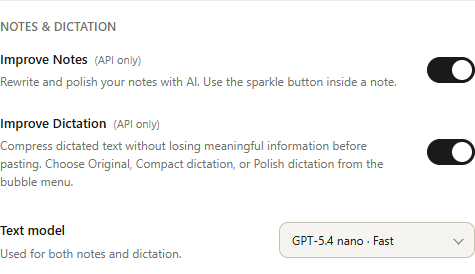

# Notes & Dictation settings — OpenFlow 1.5.27

Verified locally on 2026-11-01. Release version: 1.5.27.

## Interface

The existing divider is followed by a `Notes & Dictation` heading using the same `.section-label` type, size and 600 weight as other Settings headings. Improve Notes and Improve Dictation keep their independent API-only switches. A Text model row follows them, with copy on the left and a 196-pixel select on the right, aligned with the switch edge. The row wraps on narrow windows.

The Dictation settings arrow no longer translates on hover or menu expansion. Its background/color feedback remains and its stroke increases from 1.5 to 1.8 without moving the SVG box.

## Model choices and pricing

One persisted `noteImproveModel` setting controls notes, note suggestions, Compact dictation and Polish dictation. GPT-5.4 nano is the default. New profiles select it automatically. Older profiles using the former Luna default migrate to Nano once. Existing Sol selections and subsequent manual choices persist; unsupported historical selections fall back to Nano. A persisted `textModelDefaultVersion` marker prevents later restarts from overriding a manual Luna choice.

Standard USD prices per million tokens, checked in official model documentation on 2026-11-01:

| Model | Tier | Reasoning | Input | Cached input | Output |
| --- | --- | --- | ---: | ---: | ---: |
| GPT-5.4 nano | Fast | none | 0.20 | 0.02 | 1.25 |
| GPT-6 Luna | Balanced | medium | 0.10 | 0.01 | 0.50 |
| GPT-6 Sol | Powerful | medium | 2.00 | 0.20 | 10.00 |

For Luna/Sol prompts over 272,000 tokens, input/cached rates double and output rates increase by 50%. Standard, non-regional rates are estimates rather than invoices. Stored costs are never recalculated using the newly selected model. Historical price entries remain available for old records.

Nano is a low-latency option without a reasoning pass, not the lowest rate per token: Luna has lower published token rates. Nano is currently available but has an announced API shutdown on April 1, 2027; Luna is the recommended successor. Source references: [Nano](https://developers.openai.com/api/docs/models/gpt-5.4-nano), [Luna](https://developers.openai.com/api/docs/models/gpt-6-luna), [Sol](https://developers.openai.com/api/docs/models/gpt-6-sol), [deprecations](https://developers.openai.com/api/docs/deprecations).

## Verification

- 89 automated tests pass, including request/model selection, reasoning compatibility, pricing with cached input, persistence, fallback for unknown models, historical-cost invariance, and switching models during pending notes and queued dictation pieces.
- A running note or dictation retains its starting model for requests, result metadata and usage. New jobs use the new selection.
- Isolated Electron UI checks pass for all three choices, heading weight, select/switch alignment, key gating and renderer errors. The arrow retains exactly the same SVG box on hover/menu opening; its transform is `none` and expanded stroke is `1.8px`. Twelve mode changes retain stable native bounds, zero hidden frames and zero moved icons.
- Each model successfully completed a real synthetic note improvement and Compact dictation through the application completion path, with the correct model stored in usage. All tested dictations retained Anna, the deadline and the negated Max recipient while removing polite wrappers. Note clock formatting may normalize 14 Uhr to 14:00 Uhr without changing the deadline.

| Model | Dictation latency sample | Estimated dictation cost |
| --- | ---: | ---: |
| gpt-5.4-nano | 863 ms | $0.000182 |
| gpt-6-luna | 1733 ms | $0.000104 |
| gpt-6-sol | 1516 ms | $0.001750 |

These single synthetic samples verify integration; they do not establish universal speed, output quality or cost savings. No key or private dictation was logged.

## Build and installation

The local installer was built with `npm run dist:local`, publishing disabled: `release-local/OpenFlow-Setup-1.5.26-local.exe` (440,475,863 bytes), with a SHA-256 file alongside it. The silent per-user installer returned exit code 0. All 39 installed runtime files match the source. The installed application reports version 1.5.26 and passed the three-choice Settings selection/persistence check, heading check, Original/Polish/Compact order check and a live Compact completion. The user's previous model preference was restored after the test. All 31 pre-existing usage/version records retained their original model, stored cost and token counts across installation and model changes. The app was then restarted normally for testing.
